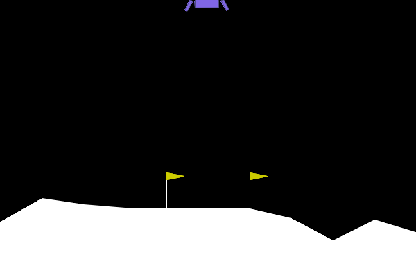
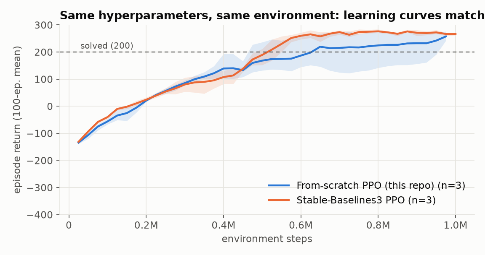
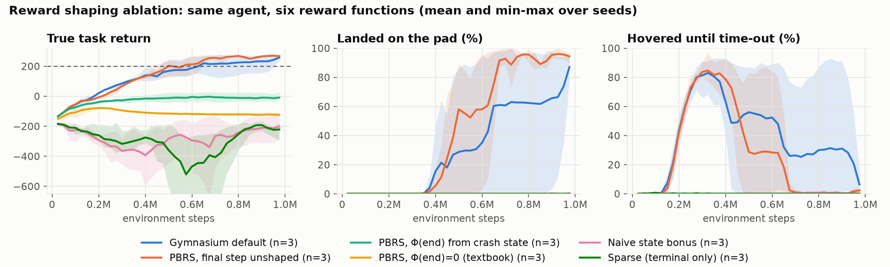
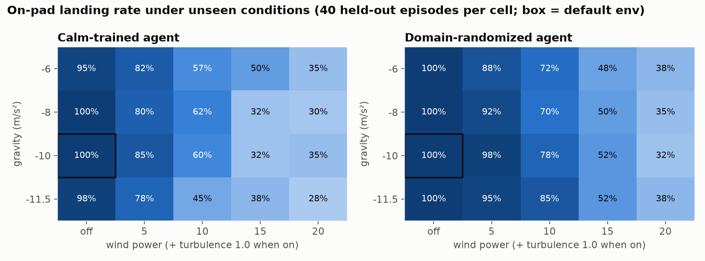

# Astro Lander

Teaching a rocket to land itself with reinforcement learning, built as an engineering and research project rather than a tutorial:

- **PPO written from scratch** in PyTorch (GAE, clipped objective, vectorized rollouts, truncation bootstrapping, observation and reward normalization). It matches Stable-Baselines3 under identical hyperparameters.
- **A reward-shaping study across 6 reward functions × 3 seeds.** Textbook potential-based shaping *fails*. The study traces the failure to three specific causes and shows that Gymnasium's default reward quietly fixes all three.
- **Robustness via domain randomization.** Training with random gravity, wind and turbulence cuts crashes in unseen weather by **3.3×**.
- **A live browser demo.** Gymnasium's Lunar Lander is ported line-for-line to JavaScript (planck.js), and the trained network runs in the page.

<p align="center">
  
  
  <br><em>Same storm (wind 18, turbulence 1.5), same starting conditions. Left: agent trained in calm air crashes. Right: domain-randomized agent lands on the pad.</em>
</p>

## Results

All numbers are measured with the deterministic policy on **100 held-out episodes per agent** (seeds never used in training), scored on the environment's true reward, and averaged over **3 training seeds**. "On pad" means the lander came to rest between the flags.

### 1. The from-scratch PPO matches Stable-Baselines3

| Agent (1M steps) | Mean score | On pad | Crashes |
|---|---|---|---|
| **From-scratch PPO (this repo)** | **272.6 ± 4.3** | **100%** | 0% |
| Stable-Baselines3 PPO, same hyperparameters | 275.6 ± 4.3 | 100% | 0% |
| From-scratch PPO, continuous throttle (2M steps) | 281.5 ± 0.8 | 100% | 0% |

The task counts as solved at an average score of 200.



### 2. Reward shaping: why the textbook method fails

Potential-based reward shaping (PBRS; Ng, Harada & Russell, 1999) adds `F = γΦ(s') − Φ(s)` to the reward and is proven to leave the optimal policy unchanged. Here Φ(s) uses the same terms as Gymnasium's built-in reward (distance to pad, speed, tilt, leg contact). In practice the textbook version never learned to land.

| Reward function | Mean score | On pad | What the agent learned |
|---|---|---|---|
| Gymnasium default | 272.6 ± 4.3 | 100% | Land |
| **PBRS, final step unshaped (fix)** | **270.1 ± 3.9** | **100%** | **Land** |
| PBRS, Φ(end) read from the crashed state | −25.8 ± 54.4 | 0% | Crash |
| PBRS, Φ(end) = 0 (textbook) | −123.2 ± 6.9 | 0% | Crash within ~70 steps |
| Naive "be near the pad" bonus | −163.1 ± 46.4 | 0% | Crash |
| Sparse (±100 at the end only) | −206.5 ± 110.8 | 0% | Crash |



**Diagnosis.** Each variant above removes one cause:

1. **Termination payout.** Φ is negative everywhere, and theory requires Φ = 0 at the terminal state. So *any* ending, a crash included, pays back +|Φ(s_last)|. An immediate crash nets about +107 in shaped reward. Landing would pay more, so the optimum really is unchanged as the theorem promises, but PPO converges to the easy crash.
2. **Impact artifact.** Reading Φ from the post-crash state doesn't fix it. The collision zeroes much of the velocity, so Φ *jumps* by +71 on average on the impact step (measured over 181 random crashes). Hitting the ground looks like progress.
3. **Fix.** Give the final transition no shaping, keeping the potential at its last value before impact. That removes both artifacts, and the agent lands on 100% of held-out episodes, matching the default reward.

Gymnasium's default reward avoids both problems without documenting it: it *overwrites* the final step's reward with exactly ±100 and uses undiscounted potential differences. A related risk turned up during development: discounted shaping with a negative Φ pays a small bonus for every step alive, and one test run learned to hover instead of land. It didn't happen in the three final seeds.

**Takeaway.** A shaping theorem guarantees where the optimum is, not that the learner reaches it. Terminal-state handling decides whether shaping helps or hurts.

### 3. Robustness: domain randomization

One agent trained in calm, default conditions. Another trained with gravity in [−11.5, −7], wind power in [0, 15] and turbulence in [0, 1.5], all re-sampled every episode. Both were then flown in a 4 × 5 grid of gravity × wind, including wind of 20, stronger than anything in training (40 held-out episodes per cell).

| Conditions | Calm-trained: on pad / crash | Randomized: on pad / crash |
|---|---|---|
| No wind (any gravity) | 98% / 1% | **100% / 0%** |
| All windy cells | 52% / 36% | **64% / 11%** |
| Storms (wind ≥ 15) | 35% / 50% | **43% / 19%** |



The main gain is **safety**. In conditions it can't fully handle, the randomized agent lands off the pad instead of crashing, with 3.3× fewer crashes across windy conditions and no cost in calm air. Randomized training is less consistent across seeds (on-pad rate in the default env: 100%, 54% and 93%). The grid compares the best seed of each training setup.

## Project layout

```
astro_lander/
  envs.py        env factory + wrappers: LandingMetrics, RewardShaping, DomainRandomization
  ppo.py         PPO from scratch (config, networks, normalizers, training loop, Policy save/load)
  evaluate.py    held-out evaluation, stress-test grid, GIF rendering
scripts/
  train.py             train one agent
  run_experiments.py   full experiment matrix (parallel, resumable)
  sb3_baseline.py      Stable-Baselines3 reference run, same hyperparameters
  analyze.py           evaluate all runs, make figures + tables
  export_policy.py     export a trained policy to JSON for the web demo
web/
  index.html     interactive demo
  lander.js      Lunar Lander physics ported to planck.js + MLP policy runner
  parity_test.js runs a policy in the JS engine and reports outcome stats (Node)
tests/           pytest suite (wrappers, PBRS math and terminal handling, normalizers, training smoke test)
configs/         optional JSON overrides for train.py
results/         figures, GIFs, per-run evaluation table (generated)
```

## Setup

Needs Python 3.10–3.13 (Box2D has prebuilt wheels for these on Windows, macOS and Linux).

```bash
python -m venv .venv
source .venv/Scripts/activate      # Git Bash on Windows; macOS/Linux: source .venv/bin/activate
pip install -r requirements.txt
pytest -q
```

## Reproduce

```bash
# one agent (~10-15 min on CPU)
python scripts/train.py --seed 1

# everything: SB3 comparison, 6 reward functions, robustness, continuous control (3 seeds each, 27 runs)
python scripts/run_experiments.py

# evaluate on 100 held-out episodes per run, stress tests, figures, GIFs -> results/
python scripts/analyze.py
```

Full matrix: about an hour with 7 parallel jobs on an 8-core laptop CPU. No GPU needed.

## How it works

**Observation (8):** x, y, vx, vy, tilt, angular velocity, left/right leg contact.
**Actions (4):** coast, left jet, main engine, right jet. The continuous variant controls throttle.

**Metrics are recorded under the shaping.** A `LandingMetrics` wrapper sits directly on the environment, so every agent is scored on the same true reward and outcome, whatever reward it was trained on.

**Evaluation is separate from training.** Training logs use the shaped reward and a stochastic (exploring) policy. Reported numbers use the deterministic policy on held-out seeds. The difference matters: several agents that looked like they were "hovering" in training logs land 100% of the time when evaluated.

**Hyperparameter note.** With 32 large minibatches per update, both this PPO and SB3 stalled with many hover-until-timeout episodes (held-out scores of 190 to 204, 16–18% timeouts). With 256 minibatches of 64 (RL-Zoo's setting), both solve the task. Hyperparameters, not the implementation, decided the outcome.

## Roadmap

| Phase | Scope | Status |
|---|---|---|
| 1. Core RL | Env wrappers, PPO from scratch, tests | Done |
| 2. Tune and validate | Hyperparameters; match SB3 over 3 seeds | Done |
| 3. Reward-shaping study | 6 reward functions × 3 seeds, diagnosis of PBRS failure | Done |
| 4. Robustness | Domain-randomized training; wind × gravity stress grid | Done |
| 5. Continuous control | Throttle-control agent | Done |
| 6. Live demo | Browser demo, JS physics port, sim-to-sim parity numbers, GitHub Pages | Built; needs final agents |
| 7. Write-up | Results, figures, GIFs | Done |

## License

MIT
